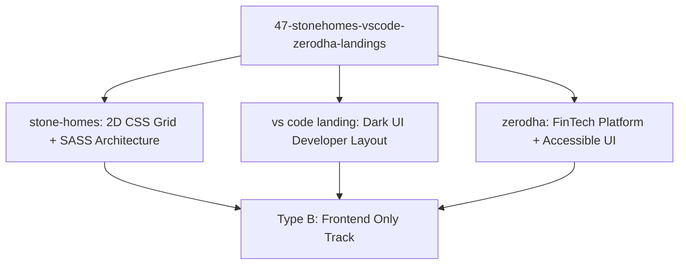

# Project Type Pre-Check: 47-StoneHomes-VSCode-Zerodha-Landings

## Step 0 Pre-Check Analysis

- **Detected Track**: **Track B: Frontend Only (CSS Grid Architecture & Triple Landing Page Showcase)**
- **Project Root**: `/Users/avishjain/avishjain9-repos/47-stonehomes-vscode-zerodha-landings`
- **Application Modules**:
  1. `stone-homes/`: Luxury Real Estate Platform engineered with pure CSS Grid and 7-1 SASS architecture.
  2. `vs code landing page /`: Developer IDE Landing Clone featuring dark theme styling and developer tooling layouts.
  3. `zerodha/`: FinTech Trading Portal Clone with accessible navigation, brokerage pricing tables, and multi-page routing.

