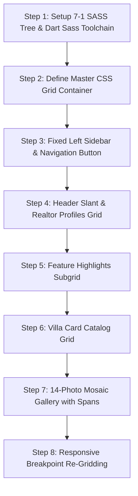

# Step-by-Step Rebuild Guide: Stone Homes (CSS Grid)



### Master Grid Declaration (`stone-homes/sass/main.scss`)
```scss
.container {
    display: grid;
    grid-template-rows: 80vh min-content 40vw repeat(3, min-content);
    grid-template-columns: 
        [sidebar-start] 8rem [sidebar-end full-start] 
        minmax(6rem, 1fr) [center-start] 
        repeat(8, [col-start] minmax(min-content, 14rem) [col-end]) [center-end] 
        minmax(6rem, 1fr) [full-end];
}
```
