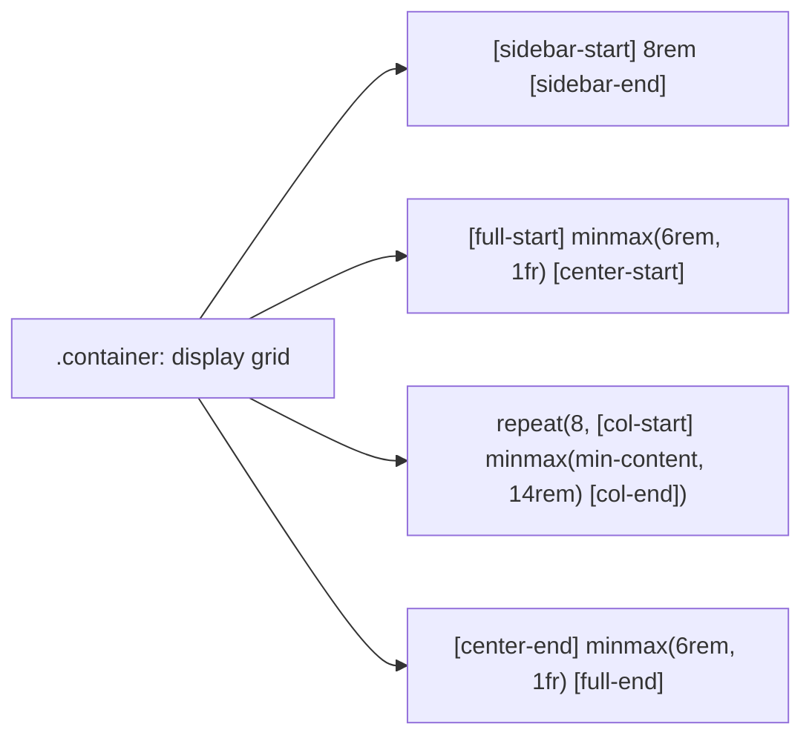

# F1: Two-Dimensional CSS Grid Master Layout

## Overview & Architecture
An 8-column central layout engineered in `stone-homes/sass/main.scss` utilizing named grid tracks and dynamic `minmax()` boundaries.

## Say It Out Loud
> "In `stone-homes/sass/main.scss`, I designed the master layout around native two-dimensional CSS Grid with named grid tracks. Instead of generic numbered lines, I named tracks like `sidebar-start`, `full-start`, and `center-start`. This allows any child section—whether it's the 80vh hero header, the 3-column features subgrid, or the full-bleed image gallery—to declare its coordinates intuitively. The 8 central columns use `minmax(min-content, 14rem)`, which prevents cards from collapsing on smaller screens while capping max widths gracefully on ultra-wide desktop monitors."
