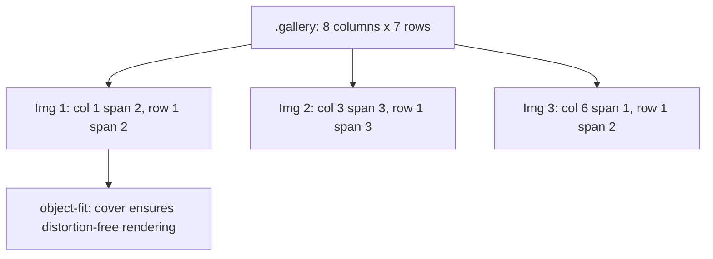

# F2: Overlapping Mosaic Image Gallery Grid

## Overview & Architecture
A 14-photograph responsive mosaic gallery in `stone-homes/sass/_gallery.scss` combining row and column spans with `object-fit: cover`.

## Say It Out Loud
> "For the real estate image showcase in `_gallery.scss`, I built a dense 14-photo mosaic gallery powered by CSS Grid. By explicitly defining row and column spans on individual image items, landscape and portrait photographs interlock seamlessly without awkward gaps. Each image uses `object-fit: cover` and `width: 100%`, ensuring photos crop cleanly and dynamically without breaking the grid proportions as the browser viewport resizes."
