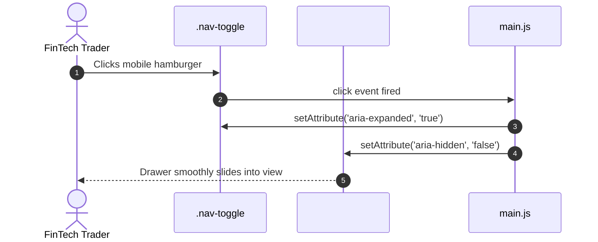

# F3: Accessible FinTech Navigation & ARIA State Machine

## Overview & Architecture
Mobile drawer menu in `zerodha/js/main.js` that synchronizes visual open/close states with accessibility attributes `aria-expanded` and `aria-hidden`.

## Say It Out Loud
> "In `zerodha/js/main.js`, I built an accessible mobile navigation drawer for the FinTech platform. When a user clicks the toggle button, the script checks the current state and synchronizes both `aria-expanded` and `aria-hidden` attributes. This ensures that screen readers and assistive technologies accurately announce whether the navigation drawer is open or collapsed, complying with WCAG 2.1 AA accessibility standards."
